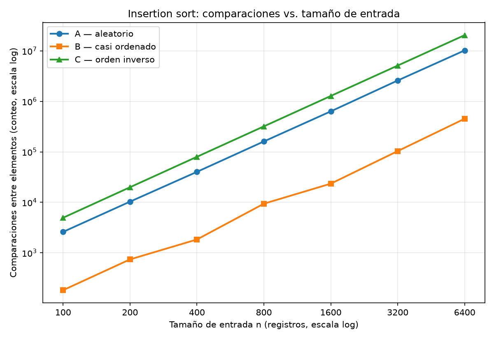
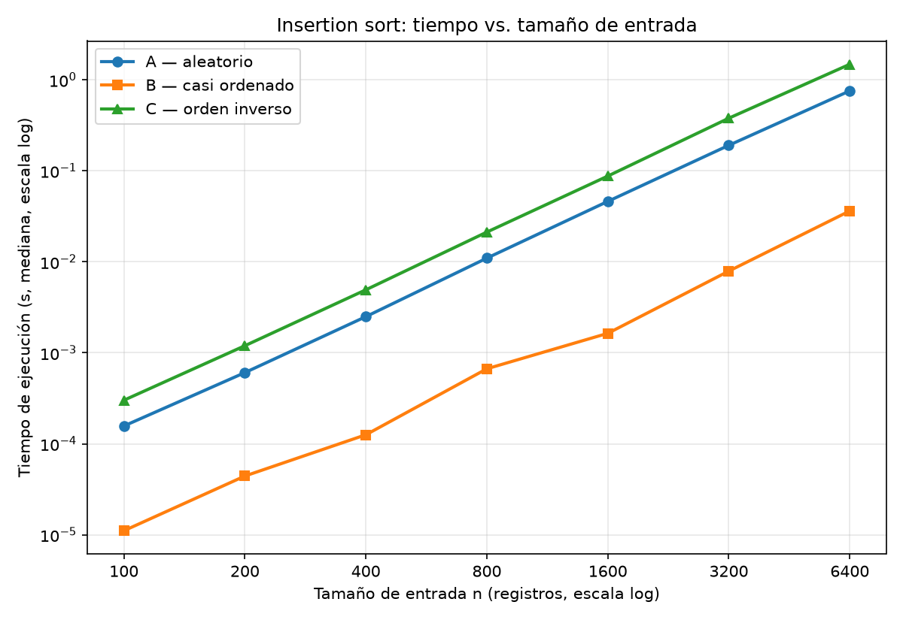
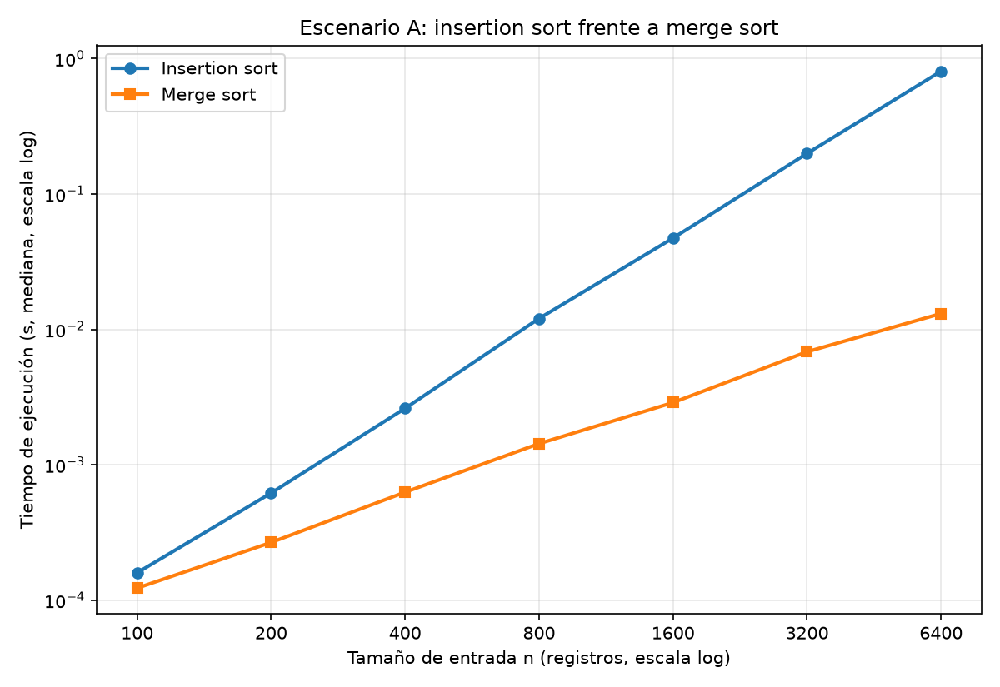

# Informe: Tamiza, corrección, eficiencia y responsabilidad técnica

## 1. Autor e instrucciones de reproducción

**Nombre completo:** Juan pablo gomez ramirez

### Activar el entorno

Los comandos siguientes se ejecutan en PowerShell desde la raíz del
repositorio `curso-analisis-algoritmos`. Si todavía no existe el entorno,
créelo con `py -m venv venv`.

```powershell
.\venv\Scripts\Activate.ps1
python -m pip install -r requirements.txt
```

### Ejecutar las Partes 3 y 4

```powershell
python .\lab1-fundamentos-complejidad-recurrencias\parte3_casos.py
python .\lab1-fundamentos-complejidad-recurrencias\parte4_complejidad.py
```

También se puede ejecutar sin activar el entorno:

```powershell
.\venv\Scripts\python.exe .\lab1-fundamentos-complejidad-recurrencias\parte3_casos.py
.\venv\Scripts\python.exe .\lab1-fundamentos-complejidad-recurrencias\parte4_complejidad.py
```

Las Partes 1 y 2 son respuestas escritas y no tienen un script.
Ambas partes prácticas imprimen tablas y guardan sus figuras en `graficas/`,
dentro de la carpeta del laboratorio. La Parte 3 genera dos gráficas y la
Parte 4 genera `parte4_tiempo.png`. Desde esa carpeta, los comandos son
`python parte3_casos.py` y `python parte4_complejidad.py`; la ubicación de
las figuras no cambia.

Parámetros compartidos por los experimentos: semilla 42; tamaños 100, 200, 400, 800, 1600,
3200 y 6400; tres ejecuciones por lote. Se informa la mediana del tiempo.
Los conteos son reproducibles; los tiempos dependen del equipo y de su carga.

---

## Parte 1 — Corrección frente a eficiencia

### Corrección y eficiencia en Tamiza

El algoritmo que ordena los datos en producción actualmente cumple con la corrección, la cual solo verifica qué produce el algoritmo y no cuánto tiempo ni cuántos recursos consume. Esto indica que un resultado correcto no garantiza que el proceso quepa en la ventana de cuatro horas, y hoy el sistema incumple esa restricción de tiempo.

### Por qué duplicar la velocidad del servidor no resuelve el problema de fondo

Un servidor del doble de velocidad reduce el tiempo por un factor constante (a la mitad), pero no cambia la forma en que el tiempo crece cuando crecen los datos, y eso lo determina el algoritmo. Si el costo (cantidad de operaciones) crece más rápido que los datos, por ejemplo de forma cuadrática, bastaría un aumento en los datos para perder toda la ganancia y volver a exceder las cuatro horas. Entonces habría que comprar otro servidor, y luego otro, en un ciclo que a la larga no es rentable.

Por eso debe analizarse primero el algoritmo: el análisis de complejidad muestra cómo crece su costo y permite decidir si el problema se resuelve mejorando el algoritmo y no solo el hardware.

### Segundo ejemplo: listado de inventario en el software de gestión interna

En un módulo del software de gestión interna de la empresa donde trabajo hay una página que lista todo el inventario. Cuando se implementó, esta hacía una consulta directa a la base de datos y traía todos los registros. En su momento funcionaba de maravilla: listaba todo de manera correcta y permitía realizar acciones de tipo CRUD sobre los registros.

Con el paso del tiempo empezaron a llegar tickets de que el módulo no cargaba o, si lo hacía, se demoraba minutos (latencia). Se revisó y, efectivamente, la consulta estaba trayendo alrededor de 6000 registros, no tenía ningún tipo de restricción y tampoco se implementaba paginación.

- **Qué se procesa:** los registros del inventario.
- **Cuántos datos:** alrededor de 6000 registros.
- **Restricción incumplida:** la latencia máxima de carga, que debería ser de 10 segundos y hoy tarda minutos.

El listado sigue siendo correcto (muestra todo el inventario), pero incumple la latencia. Un servidor más potente solo reduciría el tiempo por un factor constante, y el problema reaparecería al seguir creciendo la tabla. Lo que lo resuelve es cambiar la consulta: paginar y traer, por ejemplo, 50 registros por vez mantiene el trabajo casi constante sin importar el tamaño de la tabla, y el resultado sigue siendo correcto página a página.

---

## Parte 2 — Responsabilidad ambiental y ética del responsable técnico

### Dimensión ambiental

Si se usa un algoritmo de ordenamiento que no esté correctamente optimizado en tiempo de ejecución y cantidad de operaciones, estaríamos induciendo a un mayor gasto de energía, ya que la fórmula Energía = Potencia × Tiempo nos dice que cuanto más tiempo pase el servidor operando a alta capacidad, mayor será la electricidad total consumida.

Con el paso de los años y el aumento en el volumen de datos, el algoritmo cada vez necesita más tiempo para procesar los datos: ya no le bastan las 4 horas establecidas y podría necesitar, por ejemplo, 6 horas; si vuelven a aumentar los datos, podrían ser 8 horas, y así sucesivamente (cifras ilustrativas). A mayor tiempo, más gasto de energía.

Como el proceso corre cada madrugada, unas 365 veces al año y durante años, el gasto de una noche se repite y se acumula. El consumo total crece por dos vías a la vez: cada noche dura más y se repite muchas más veces. Duplicar la velocidad del servidor no cambia esa tendencia, y un equipo adicional suma su propio consumo y fabricación. Por eso me corresponde elegir un algoritmo cuyo costo crezca lentamente con los datos.

### Dimensión ética

**1. Lista tardía.** Si el ordenamiento no está listo cuando empiezan las llamadas, un paciente de índice alto, que debía ser llamado a primera hora, recibe su llamada tarde o no la recibe.

- **Quién asume el costo:** primero el paciente, que sufre la atención tardía. Luego el operador del centro de contacto, que queda sin lista o trabaja con una desactualizada y recibe las quejas. La Secretaría asume el costo institucional.
- **Responsabilidad:** compartida. El equipo de desarrollo, por un algoritmo lento; la Secretaría, si no vigila la hora de entrega ni avisa cuando falla.

**2. Orden erróneo.** Un paciente con índice alto queda por debajo de uno con índice bajo y espera más de lo debido.

- **Quién asume el costo:** el paciente mal ubicado. También el operador, que sigue la lista de buena fe sin poder detectar el error, y la Secretaría, que responde ante la institución.
- **Responsabilidad:** el equipo de desarrollo responde de que el algoritmo cumpla su especificación, pero no es el único responsable. El índice y sus reglas vienen de la Secretaría, y si están mal definidos o los datos de entrada son erróneos, el ordenamiento puede ser correcto y la lista injusta.

### La tensión: el orden decide a quién se llama primero

El orden de la lista decide a quién se llama primero, y eso hace que la corrección deje de ser solo un requisito técnico y se vuelva una obligación ética. Impone tres deberes adicionales al tiempo:

- **Demostrar la corrección, no solo probarla.** Los tests cubren únicamente los casos probados. Además de los casos límite (listas vacías, valores repetidos, índices extremos), debo demostrar el algoritmo con un invariante de bucle.
- **Definir el desempate.** Con 1.200.000 pacientes habrá muchos con el mismo índice. El criterio (por ejemplo, la fecha de última atención) debe ser explícito, estable y documentado, porque decide quién recibe la llamada antes.
- **Vigilar el tiempo.** Una lista correcta que llega tarde equivale a no tenerla, así que debo monitorear la duración del proceso y alertar antes de que incumpla la ventana.

Como responsable técnico, no puedo garantizar que nadie sufra daño, pero sí que el algoritmo sea correcto, eficiente y verificable, y que cualquier falla se detecte a tiempo.

---
## Parte 3 — Peor caso, mejor caso y caso promedio

El [código de la Parte 3](parte3_casos.py) usa las funciones de
[algoritmos.py](algoritmos.py) y los generadores de [datos.py](datos.py).

### 3.1 Explicación y predicción

Para comparar los casos mantengo fijo el tamaño n. En el experimento,
Iₙ contiene todas las permutaciones de los enteros distintos de 0 a n−1,
y T(x) cuenta las comparaciones que hace insertion sort con la entrada x.

- **Peor caso:** W(n) = máx {T(x) : x ∈ Iₙ}. Es el mayor costo entre
  todas las entradas de ese tamaño.
- **Mejor caso:** B(n) = mín {T(x) : x ∈ Iₙ}. Es el menor costo dentro
  del mismo conjunto.
- **Caso promedio:** A(n) = Σ P(x)·T(x), sobre x ∈ Iₙ. Depende de la
  distribución de las entradas; para A supongo permutaciones
  igualmente probables, con P(x) = 1/n!.

Para decidir si Tamiza entra en producción usaría **el peor caso**.
La ventana de cuatro horas debe cumplirse aunque cambie el canal.
El mejor caso es demasiado favorable y el promedio puede esconder
ejecuciones que se pasan del límite. La cota de trabajo debe
comprobarse también en tiempo sobre el servidor de producción.

**Predicción previa al experimento, conservada:**

Peor caso: escenario C. Se ordena de mayor a menor y el sistema legado entrega los registros de menor a mayor, es decir, en orden exactamente inverso. Cada registro debe recorrer toda la parte ya ordenada.

Mejor caso: escenario B, con una aclaración. El mejor caso teórico es una lista ya ordenada de mayor a menor (n − 1 comparaciones), y ningún escenario lo es exactamente. B es el más cercano porque el 98 % ya viene ordenado, pero predigo que no será lineal: los registros nuevos del final (el 2 %) deben desplazarse cada uno por la lista, lo que da unas 0,0098 n² ≈ 1,4 × 10¹⁰ operaciones. Es el más barato de los tres, pero sigue siendo cuadrático.

Escenario A: caso promedio. Con orden aleatorio se esperan unas n²/4 ≈ 3,6 × 10¹¹ operaciones, la mitad que en C.

Las razones previstas eran C/A ≈ 2, A/B ≈ 25 y C/B ≈ 50.

### 3.2 Demostración experimental

Se usaron los siete tamaños de las tablas, semilla 42 y tres ejecuciones
por lote. A genera una permutación aleatoria; B deja el 98 % en orden
descendente y agrega el 2 % restante al final; C genera el orden
ascendente. Todos producen n valores distintos.

Se midió solo la llamada al algoritmo con `time.perf_counter()`,
incluida su copia interna. La generación y la verificación quedaron
fuera del cronómetro. El contador registra comparaciones entre
elementos, no condiciones de índices o ciclos. No se usan
`sorted()` ni `list.sort()`.

Mediciones del 20 de septiembre de 2026, en Windows 11 y Python 3.14.3.
Los tiempos son medianas de las tres ejecuciones:

| n | Comparaciones A | Comparaciones B | Comparaciones C |
|---:|---:|---:|---:|
| 100 | 2.598 | 182 | 4.950 |
| 200 | 10.318 | 741 | 19.900 |
| 400 | 40.147 | 1.837 | 79.800 |
| 800 | 160.702 | 9.393 | 319.600 |
| 1.600 | 633.907 | 23.433 | 1.279.200 |
| 3.200 | 2.591.681 | 103.492 | 5.118.400 |
| 6.400 | 10.212.827 | 452.646 | 20.476.800 |

| n | Tiempo A (s) | Tiempo B (s) | Tiempo C (s) |
|---:|---:|---:|---:|
| 100 | 0,00015710 | 0,00001110 | 0,00030140 |
| 200 | 0,00060620 | 0,00004430 | 0,00119690 |
| 400 | 0,00249770 | 0,00012580 | 0,00492460 |
| 800 | 0,01097610 | 0,00066790 | 0,02120990 |
| 1.600 | 0,04612480 | 0,00163780 | 0,08753850 |
| 3.200 | 0,19053310 | 0,00790640 | 0,37842250 |
| 6.400 | 0,75591660 | 0,03621700 | 1,48055340 |





**Resultados y contraste con la predicción:**

- **C fue el peor:** coincide con n(n−1)/2 en todos los tamaños.
  Para n = 6.400 son 20.476.800 comparaciones.
- **B fue el menos costoso:** hizo 452.646 comparaciones con n = 6.400.
  No es el mejor caso teórico: una lista totalmente ordenada del mismo
  tamaño necesita solo 6.399.
- **A se aproxima al promedio uniforme:** sus 10.212.827 comparaciones
  con n = 6.400 quedan un 0,27 % por debajo de n²/4.

Las gráficas mantienen C > A > B tanto en comparaciones como en tiempo.
Al duplicar n de 3.200 a 6.400, los conteos crecen por factores de
3,94, 4,37 y 4,00 para A, B y C. Esto respalda el crecimiento cuadrático;
en estos ejes logarítmicos corresponde a una pendiente cercana a 2.

El orden previsto se cumplió. Las razones finales fueron C/A = 2,01,
A/B = 22,6 y C/B = 45,2. B quedó un 12,76 % por encima de 0,0098 n²:
la predicción omitió las inversiones entre los propios registros
nuevos y las comparaciones que detienen los desplazamientos.
Si m = 0,02n, las inversiones esperadas son
m(n−m)/2 + m(m−1)/4, cuyo término principal es aproximadamente
0,0099 n². Además, la selección aleatoria de los nuevos hace variar
el resultado de una semilla a otra.

Los datos reales de Tamiza tienen n = 1.200.000 y riesgos entre 0 y
1000, con empates. Aquí se usan valores distintos porque así lo pide
el experimento. Repetir el mismo lote tres veces reduce la variación
del tiempo, pero no equivale a promediar entradas de distintas semillas.

---

## Parte 4 — Complejidad de merge sort e insertion sort: cálculo y validación

El [código de la Parte 4](parte4_complejidad.py) compara los algoritmos
de [algoritmos.py](algoritmos.py) sobre el escenario A de
[datos.py](datos.py).

### 4.1 Cálculo teórico

Aquí T(n) cuenta el trabajo total, incluidas copias, ciclos y
asignaciones. El contador del código registra solo comparaciones.

#### Merge sort: árbol de recursión

Merge sort resuelve **dos subproblemas de tamaño n/2** y luego mezcla
sus resultados. Copiar, dividir y combinar cuesta Θ(n): cada elemento
debe llegar a la lista resultante, incluso si la entrada ya está ordenada.

```text
T(n) = 2T(n/2) + Θ(n)
T(1) = Θ(1)
```

Para n = 2ᵏ, represento el trabajo lineal de cada llamada por c·n:

```text
Nivel              Subproblemas                       Costo del nivel
  0                    T(n)                                 c*n
                     /      \
  1             T(n/2)      T(n/2)                    2*c*(n/2) = c*n
                /   \       /   \
  2         T(n/4) T(n/4) T(n/4) T(n/4)              4*c*(n/4) = c*n
                         ...
  j              2^j nodos T(n/2^j)               2^j*c*(n/2^j) = c*n
                         ...
  k                n hojas T(1)                             b*n
```

En cada nivel interno, los tamaños suman n, por lo que el trabajo
es cn. Las hojas aparecen cuando n/2ᵏ = 1; entonces k = log₂ n.
Hay log₂ n niveles internos y un nivel de hojas. Sumando:

```text
T(n) = sum(j = 0 hasta k-1) c*n + b*n
     = c*n*k + b*n
     = c*n*log₂(n) + b*n
     = Θ(n log n)
```

El costo local tiene cotas lineales superior e inferior, así que el
resultado es Θ(n log n). Si n no es potencia de dos, se divide en
⌊n/2⌋ y ⌈n/2⌉; el redondeo no cambia la cota.

#### Insertion sort: cálculo línea por línea

En la iteración i, sᵢ es el número de desplazamientos y fᵢ vale 1
si se termina con `break`, o 0 si la clave llega al principio.
Defino S = Σsᵢ y F = Σfᵢ, con 0 ≤ F ≤ n−1.
El `while` evalúa su condición sᵢ+1 veces, pero solo hace sᵢ+fᵢ
comparaciones entre elementos.

Para n ≥ 2, cada cᵢ representa un costo constante. La copia de la
primera línea cuesta Θ(n); los demás accesos y asignaciones se
consideran constantes.

| Línea | Instrucción | Número de ejecuciones | Costo total |
|---:|---|---|---|
| 1 | `lista = list(datos)` | 1 copia de n elementos | c₁n |
| 2 | `comparaciones = 0` | 1 | c₂ |
| 3 | `for i in range(1, len(lista)):` | n controles: n−1 iteraciones y fin | c₃n |
| 4 | `clave = lista[i]` | n−1 | c₄(n−1) |
| 5 | `j = i - 1` | n−1 | c₅(n−1) |
| 6 | `while j >= 0:` | S+n−1 | c₆(S+n−1) |
| 7 | `comparaciones += 1` | S+F | c₇(S+F) |
| 8 | `if lista[j] >= clave:` | S+F | c₈(S+F) |
| 9 | `break` | F | c₉F |
| 10 | `lista[j + 1] = lista[j]` | S | c₁₀S |
| 11 | `j -= 1` | S | c₁₁S |
| 12 | `lista[j + 1] = clave` | n−1 | c₁₂(n−1) |
| 13 | `return lista, comparaciones` | 1 | c₁₃ |

La fila del `for` incluye n−1 iteraciones y la comprobación final.
Sumando los costos de las 13 líneas:

```text
T(n, x) = c1*n + c2 + c3*n
        + (c4 + c5 + c12)*(n - 1)
        + c6*(S + n - 1)
        + (c7 + c8)*(S + F)
        + c9*F + (c10 + c11)*S + c13

T(n, x) = Θ(n + S + F) = Θ(n + S), porque F <= n - 1.
```

- **Mejor caso:** la lista ya está en orden descendente. S = 0 y
  F = n−1; por tanto, T(n) = Θ(n).
- **Peor caso:** cada clave desplaza los i elementos anteriores.
  S = 1 + 2 + … + (n−1). Al sumar esa serie con la misma serie
  invertida, 2S = n(n−1), de donde S = n(n−1)/2.
  Así, T(n) = Θ(n + n(n−1)/2) = Θ(n²).
- **Promedio uniforme:** cada par tiene probabilidad 1/2 de ser una
  inversión. Como hay n(n−1)/2 pares, E[S] = n(n−1)/4.
  Luego E[T(n)] = Θ(n + n(n−1)/4) = Θ(n²).

| Algoritmo | Mejor caso | Peor caso | Promedio uniforme |
|---|---|---|---|
| Insertion sort | Θ(n) | Θ(n²) | Θ(n²) |
| Merge sort de esta implementación | Θ(n log n) | Θ(n log n) | Θ(n log n) |

Merge sort mantiene esa cota en los tres casos porque esta versión
siempre divide y mezcla. Las entradas vacías o unitarias cuestan Θ(1).

### 4.2 Validación experimental

Se usaron los mismos tamaños, semilla y entorno de la Parte 3.
Cada algoritmo recibió el mismo lote aleatorio y se cronometró solo
su llamada. Se alternó el orden de ejecución y se tomó la mediana
de tres repeticiones. La verificación de orden, conservación de
elementos y entrada intacta quedó fuera del cronómetro.

| n | Comparaciones insertion | Comparaciones merge | Tiempo insertion (s) | Tiempo merge (s) |
|---:|---:|---:|---:|---:|
| 100 | 2.598 | 545 | 0,00015970 | 0,00012310 |
| 200 | 10.318 | 1.283 | 0,00061960 | 0,00026750 |
| 400 | 40.147 | 2.964 | 0,00261450 | 0,00062840 |
| 800 | 160.702 | 6.732 | 0,01204830 | 0,00143550 |
| 1.600 | 633.907 | 15.046 | 0,04727760 | 0,00288550 |
| 3.200 | 2.591.681 | 33.248 | 0,19949600 | 0,00684320 |
| 6.400 | 10.212.827 | 72.982 | 0,80759750 | 0,01310200 |



**Merge sort fue más rápido en los siete tamaños.** Las dos curvas
suben, pero la de insertion sort crece más deprisa. Con n = 100,
la razón de tiempos es 1,30; con n = 6.400 llega a 61,64.

Al pasar de 3.200 a 6.400 registros, insertion sort tarda 4,05 veces
más y merge sort 1,91 veces más. Esto concuerda con Θ(n²) frente
a Θ(n log n), aunque el segundo factor no coincide exactamente con
el 2,17 del modelo: también intervienen constantes y variaciones
de la ejecución.

En los tamaños pequeños no se invirtió el orden, pero la diferencia
fue menor porque pesan más las llamadas, copias y recursión.
Para Tamiza elegiría merge sort: su ventaja medida aumenta con n.
Estos tiempos vienen de una ejecución distinta de la Parte 3;
las comparaciones coinciden, aunque los tiempos varíen.

### 4.3 Concepto técnico a la Secretaría de Salud

Al equipo de ingeniería de la Secretaría de Salud:

Recomiendo cambiar insertion sort por merge sort y mantener un solo algoritmo para los tres canales. No conviene depender de que el lote conserve el orden del día anterior: una migración puede cambiar la entrada sin aviso. Merge sort mantiene una cota Θ(n log n) en el mejor, el peor y el caso promedio. Ese límite permite elegir una implementación sin tener que detectar el escenario cada madrugada.

La [gráfica de la Parte 4](graficas/parte4_tiempo.png) muestra la diferencia. Con 6.400 registros aleatorios, insertion sort tardó 0,80759750 s y merge sort 0,01310200 s, usando la mediana de tres ejecuciones. El primero tardó unas 61,6 veces lo que tardó el segundo. Al pasar de 3.200 a 6.400 registros, sus tiempos crecieron por factores de 4,05 y 1,91. La ventaja de merge sort aumenta con el tamaño del lote.

Para estimar el tiempo con N = 1.200.000, uso n₀ = 6.400 como referencia. Multiplico el tiempo de insertion sort por (N/n₀)² = 35.156,25 y obtengo unas 7,89 horas para A. En merge sort uso (N log₂ N)/(n₀ log₂ n₀) ≈ 299,47 y obtengo unos 3,92 segundos. Con ese cálculo, el algoritmo actual supera las cuatro horas y el recomendado cabe en la ventana.

Son estimaciones, no mediciones del lote completo. Suponen un costo por operación comparable al de este equipo y no incluyen lectura de registros, escritura de resultados ni otras cargas del servidor. La proyección de merge sort parte del escenario A; no garantiza el tiempo máximo del proceso en producción.

No recomiendo comprar el servidor del doble de velocidad como solución principal. Incluso si redujera el tiempo exactamente a la mitad, A quedaría en 3,94 horas, casi sin margen. Para C, la [gráfica de la Parte 3](graficas/parte3_tiempo.png) registra 1,48055340 s con 6.400 registros. Al extrapolar resultan 14,46 horas, o 7,23 horas con el servidor propuesto: todavía fuera de la ventana.

También hay que revisar la memoria. Merge sort requiere espacio auxiliar Θ(n) y una pila Θ(log n); insertion sort también copia la entrada en esta implementación, así que el cambio no demuestra un ahorro de memoria. Ambos conservan el orden de los empates, pero la Secretaría debe definir el criterio de desempate. Antes de desplegar el cambio, probaría los tres canales con registros reales y mediría el proceso completo. La validación debe comprobar tanto la duración como que ningún registro se pierda o cambie de prioridad. Esa prueba permitiría decidir después si hace falta ampliar el servidor.
