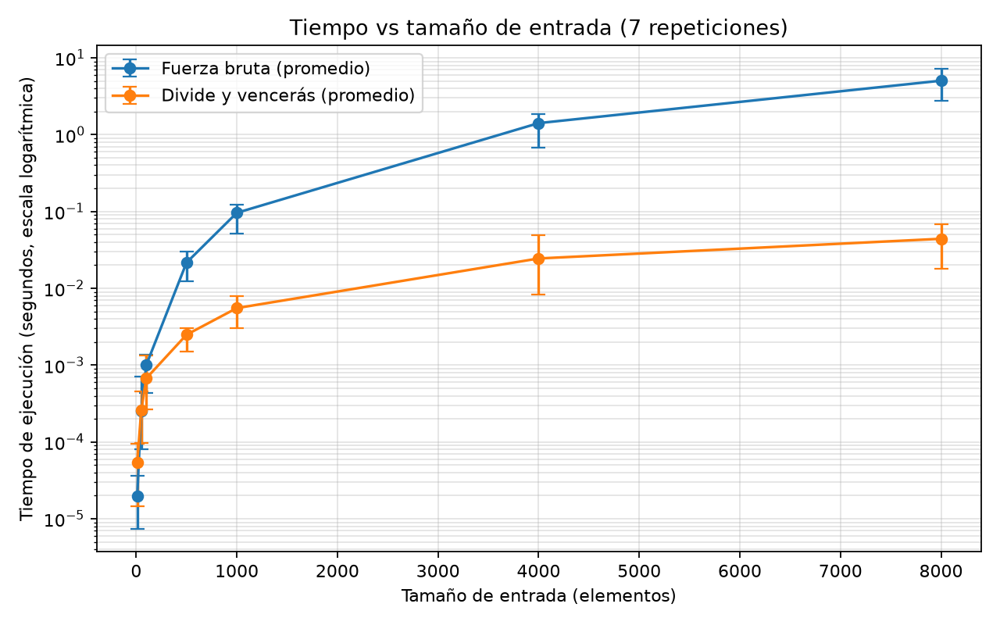

# Laboratorio 2: Divide y vencerás

## Datos e instrucciones para reproducir el experimento

**Nombre completo:** Juan pablo gomez ramirez

Ejecuta estos comandos desde la raíz del repositorio:

```powershell
# Activar el entorno virtual
.\venv\Scripts\Activate.ps1

# Ejecutar las pruebas
python lab2-divide-y-vencer/pruebas.py

# Ejecutar la medición y generar la gráfica
python lab2-divide-y-vencer/medicion.py
```

## Parte 1 — Verificación de las soluciones

**Código:** [subarreglo.py](subarreglo.py) · [pruebas.py](pruebas.py)

### Verificación y casos cubiertos

Para comprobar que ambas soluciones eran correctan se uso la palabra reservada "assert" la cual nos permite verificar supociones y/o condiciones lógicas durante la ejecución del programa.

```python
assert subarreglo_fuerza_bruta(serie)[2] == 17
```

`[2]` -> accede al resultado de la suma  
`[2] == 17` -> valida que el resultado de la suma sea igual a `17`

Para comprbar la validez de ambos algoritmo se validaron varios casos:

#### El primer caso en ser probado fue el base

Serie: `-3   +5   -2   +8   -6   +3   +9   -4`

En este ya se nos daba la solución del sub arreglo máximo la cual era `17` y se uso como primera comprobación

```python
serie = [-3, 5, -2, 8, -6, 3, 9, -4]
assert subarreglo_fuerza_bruta(serie)[2] == 17
assert subarreglo_maximo(serie, 0, len(serie) - 1)[2] == 17
```

#### Segunda comprobación se uso un solo valor

Serie: `[-3]`

```python
serie = [-3]
assert subarreglo_fuerza_bruta(serie)[2] == -3
assert subarreglo_maximo(serie, 0, len(serie) - 1)[2] == -3
```

#### Tercera comprobación todos los elementos negativos

Serie: `[-2, -1, -3, -4, -1, -2, -1, -5, -4]`

```python
serie = [-2, -1, -3, -4, -1, -2, -1, -5, -4]
assert subarreglo_fuerza_bruta(serie)[2] == -1
assert subarreglo_maximo(serie, 0, len(serie) - 1)[2] == -1
```

#### Cuarta comprobación todos los elementos positivos

Serie: `[2, 1, 3, 4, 1, 2, 1, 5, 4]`

```python
serie = [2, 1, 3, 4, 1, 2, 1, 5, 4]
assert subarreglo_fuerza_bruta(serie)[2] == 23
assert subarreglo_maximo(serie, 0, len(serie) - 1)[2] == 23
```

#### Quinta comprobación el mejor tramo cruza el punto medio

Para serie = `[-2, 4, 3, -1, 5, -2]`

El punto medio está en el índice `2`. El mejor tramo va del índice `1` al `4`, así que cruza el punto medio. La suma máxima es `4 + 3 - 1 + 5 = 11`.

```python
serie = [-2, 4, 3, -1, 5, -2]
assert subarreglo_fuerza_bruta(serie)[2] == 11
assert subarreglo_maximo(serie, 0, len(serie) - 1)[2] == 11
```

#### Sexta comprobación 20 listas aleatorias

Se uso un generador de listas que recibe un `n` como tamaño de la lista  y genera número de manera aleatoria entre `(-100,100)`.

`serie[aleatoria]`

```python
def generar_entradas(n: int) -> list[int]:
    entrada = [random.randint(-100, 100) for _ in range(n)]
    random.shuffle(entrada)
    return entrada


for i in range(20):
    serie = generar_entradas(random.randint(1, 100))
    assert subarreglo_fuerza_bruta(serie)[2] == subarreglo_maximo(
        serie, 0, len(serie) - 1
    )[2]
```

## Parte 2 — Medición de tiempos

**Código:** [medicion.py](medicion.py)



### Procedimiento de medición

Se fijó la semilla en `42` y se midieron siete entradas aleatorias nuevas para cada tamaño. En cada repetición se intercalaron los tamaños, se midieron ambos algoritmos y se alternó cuál corría primero. `perf_counter()` midió solo la llamada al algoritmo. La gráfica usa el promedio aritmético de las siete mediciones y sus barras muestran el mínimo y el máximo observados. El eje vertical es logarítmico para que se distingan las dos curvas.

```python
inicio = perf_counter()
resultado = algoritmo(serie)
tiempo = perf_counter() - inicio
```

Los datos se generan aleatoriamente; estos son los tamaños y la semilla usados por el script:

```python
random.seed(42)
tamanios = [10, 50, 100, 500, 1000, 4000, 8000]
repeticiones = 7
```

La siguiente tabla contiene los promedios que se grafican. Se imprimen con la misma precisión al ejecutar `medicion.py`:

| Tamaño `n` | Fuerza bruta, promedio (s) | Divide y vencerás, promedio (s) |
| ---: | ---: | ---: |
| 10 | 0,000019814 | 0,000053557 |
| 50 | 0,000255186 | 0,000257171 |
| 100 | 0,001003157 | 0,000673271 |
| 500 | 0,021593029 | 0,002488486 |
| 1.000 | 0,096105514 | 0,005529000 |
| 4.000 | 1,412613571 | 0,024458571 |
| 8.000 | 5,040943786 | 0,044135114 |


## Parte 3 — Análisis

### 1. Recurrencia y complejidad

Para `n > 1`, `subarreglo_maximo` hace dos llamadas recursivas: una para la mitad izquierda y otra para la mitad derecha, cada una con aproximadamente `n/2` elementos. También busca el mejor tramo que cruza el punto medio. Ese barrido recorre las dos mitades una vez, por lo que cuesta `Θ(n)`; comparar los tres resultados cuesta `Θ(1)`. El caso base, con un solo elemento, cuesta `Θ(1)`. Por tanto:

```text
T(1) = Θ(1)
T(n) = 2T(n/2) + Θ(n)
```

En el método maestro, `a = 2`, `b = 2` y `f(n) = Θ(n)`. Como `n^(log_b(a)) = n^(log_2(2)) = n`, se cumple que `f(n) = Θ(n^(log_b(a)))`. Aplica el caso 2 del método maestro, con `k = 0`, y resulta `T(n) = Θ(n log n)`.

La fuerza bruta considera cada par de índices `(i, j)`, es decir, cada tramo contiguo. Hay `n(n+1)/2` tramos, que es `Θ(n²)`. Como extiende cada tramo sumando un elemento en tiempo constante, el trabajo total también es `Θ(n²)`.

### 2. Lo medido contra lo esperado

En las últimas dos filas, fuerza bruta pasa de `1,412613571 s` a `5,040943786 s`, un factor de `3,57`. Divide y vencerás pasa de `0,024458571 s` a `0,044135114 s`, un factor de `1,80`. La gráfica muestra esos mismos promedios y las barras muestran el rango de las siete mediciones.

Al duplicar `n`, los modelos predicen factores de `4` para `Θ(n²)` y de `2 log₂(8000) / log₂(4000) ≈ 2,17` para `Θ(n log n)`. El factor de fuerza bruta queda cerca de `4`; el de divide y vencerás aumenta, pero queda por debajo de `2,17`. Las barras de rango muestran variación entre repeticiones, así que estos resultados son compatibles con las tendencias esperadas, pero no bastan para afirmar una coincidencia precisa. La complejidad se obtiene del análisis del algoritmo; los tiempos medidos dependen también del equipo y de la carga durante la ejecución.

### 3. Tamaños pequeños

Según los promedios de esta ejecución, fuerza bruta tarda menos en `n = 10` y `n = 50`, mientras que divide y vencerás tarda menos desde `n = 100`. El cruce observado queda entre `50` y `100`. Para entradas pequeñas, las llamadas recursivas y el trabajo de dividir y combinar pueden superar el ahorro de operaciones. El cruce es aproximado y depende de estas mediciones y del equipo.

### 4. ¿Cuándo conviene dividir?

Para hallar el máximo de un arreglo, se puede dividir el arreglo en dos mitades, hallar el máximo de cada mitad y combinar los dos resultados comparándolos en tiempo constante. La recurrencia sería `T(n) = 2T(n/2) + Θ(1)`, que por el método maestro también da `Θ(n)`. Un recorrido lineal mantiene el máximo actual y cuesta `Θ(n)`. Dividir no mejora el orden de crecimiento y agrega llamadas recursivas, así que para este problema conviene el recorrido lineal.

### 5. Concepto para la gerente

Recomiendo divide y vencerás para procesar una serie de un millón de registros: su crecimiento `n log n` es mucho menor que el crecimiento cuadrático de la fuerza bruta. Tomando como referencia los promedios de `n = 8000` de esta ejecución (`5,040943786 s` para fuerza bruta y `0,044135114 s` para divide y vencerás), las siguientes cifras son **estimaciones basadas en los modelos de complejidad**, no mediciones directas:

- Fuerza bruta: `5,040943786 × (1.000.000 / 8.000)² ≈ 78.765 s`, es decir, alrededor de `21,9 horas`.
- Divide y vencerás: `0,044135114 × (1.000.000 log₂(1.000.000) / (8.000 log₂(8.000))) ≈ 0,044135114 × 192,2 ≈ 8,5 s`.

Estas proyecciones escalan cada tiempo según su complejidad (`n²` o `n log n`), no mediante una regla de tres lineal. Son ilustrativas y heredan la variación observada en las mediciones. El tiempo real dependerá del equipo, la implementación y las condiciones de ejecución.
